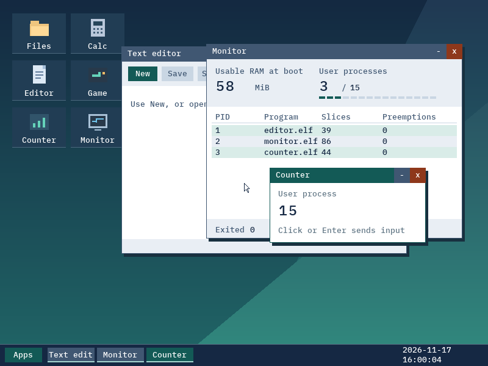

# Dlang OS

Dで実装したx86-64の小さな自作OSです。UEFIで起動し、GUIデスクトップとシリアルシェルを使えます。ファイル管理、テキスト編集、電卓、スネークなどのアプリを同梱しています。実機での起動は未検証です。



## 起動

GNU Make、内蔵LLD付きのLDC 1.43.0、`lld-link`、QEMU、x86-64用OVMF、Python 3が必要です。配置やパスの指定は [ビルドとテスト](docs/build.md) を参照してください。

```sh
./configure
make run-gui
```

ウィンドウなしで使う場合は `make run`、テストは `make test` を実行します。ファイルは `build/data.img` に保存されます。以前に作ったデータディスクを使う場合は、QEMUを終了して `make install-apps` を実行してください。

## 参考資料

- [QEMUでの使い方](docs/usage.md)：デスクトップの操作、ファイル保存、シェルコマンド
- [ビルドとテスト](docs/build.md)：必要なツール、パスの指定、テスト内容
- [実装の詳細](docs/architecture.md)：起動処理、プロセス、メモリ、時刻、ストレージ
- [デスクトップアプリの登録](docs/desktop-apps.md)
- [DlangFSのディスク形式](docs/dlangfs.md)
- [アプリ開発とABI](apps/README.md)
- [標準druntimeの移植基盤とライセンス](docs/druntime.md)
- [Hello,world実装](docs/phobos.md)
- [フォントのライセンスと生成手順](assets/fonts/README.md)
