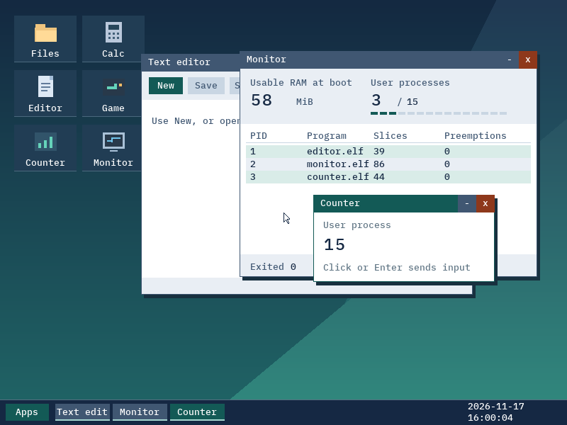

# はじめに {.unnumbered}

本書は、D言語（主に `-betterC` サブセット）で実装された x86-64 向けの小さな自作OS **Dlang OS** を題材に、オペレーティングシステムの仕組みを実際のソースコードを引用しながらステップバイステップで学ぶチュートリアルブックです。



## 本書で学べること

OSの教科書で語られる概念——ブート、ページング、特権レベル（Ring 0 / Ring 3）、割り込み、プリエンプティブマルチタスク、ELFローダー、ブロックデバイスドライバ、ファイルシステム、GUIウィンドウシステム——は、抽象的な理論だけでは全体像をつかみにくいものです。

Dlang OSのカーネルとアプリを、次の機能ごとに読み進めます。

- **UEFI ローダー** (`boot/loader.d`, `boot/boot_paging.d`): ファームウェアから画面（GOP）とメモリマップを受け取り、4段階ページテーブルを構築してカーネルを起動します。
- **カーネル初期化と時刻・メモリ管理** (`source/kernel.d`, `source/clock.d`, `source/physical_memory.d`): PITでTSCを校正し、4 KiB単位の物理ページを管理します。
- **特権分離とプリエンプション** (`source/privilege.d`, `source/apic_timer.d`): GDT・TSS・IDT を構築し、`INT 0x80` によるシステムコールとローカル APIC タイマーによる約 5 ms 単位のタイムスライスを実現します。
- **プロセス管理と ELF ローダー** (`source/process.d`, `source/elf.d`, `source/address_space.d`): 静的な ELF64 実行ファイルを検証して独立した仮想空間へロードし、最大 15 プロセスをラウンドロビンで実行します。
- **ストレージと2世代ファイルシステム** (`source/ata.d`, `source/filesystem.d`): PCI IDE 経由で ATA PIO ディスクを検出し、2世代コピーと FNV-1a チェックサムでクラッシュ耐性を持たせた **DlangFS** を提供します。
- **GUI デスクトップと Ring 3 アプリ** (`source/graphics.d`, `source/gui.d`, `apps/counter/counter.d`): バックバッファ合成・差分転送によるデスクトップ環境と、その上で動く独立した ELF アプリケーションを実装しています。

::: {.callout-note}
### 本書のコード引用について
Dコードの引用には、リポジトリ内のファイルパスと行範囲を記載しています。行番号は校正時点のもので、変更後は関数名も手掛かりにしてください。実行コマンド、構成図、実習用の変更例は、引用コードとは別に示しています。
:::

## リポジトリの構成

| パス | 役割 |
| --- | --- |
| `boot/` | UEFI ブートローダー（`loader.d`）、ページテーブル構築（`boot_paging.d`）、カーネルELF読み込み（`kernel_image.d`） |
| `source/` | カーネル本体、ドライバ（`pci.d`, `ata.d`, `ps2.d`, `serial.d`）、メモリ・プロセス管理、DlangFS、GUI |
| `apps/` | ユーザー空間（Ring 3）で動く ELF アプリ（`builtin/`, `counter/`, `experiments/`）と共通 ABI（`user_api.d`） |
| `runtime/` | 標準 `druntime` / Phobos 移植基盤とリンカスクリプト |
| `tools/` | 仮想ディスク作成（`format-disk.py`）、アプリ配置（`install-apps.py`）などの補助スクリプト |
| `tests/` | QEMU 上で自動実行する結合テスト群 |

## 読み進め方

第1〜6章では、起動からGUIまでの実装を順に読みます。[第7章](07-runtime.qmd)では標準druntimeとPhobosがアプリの起動・出力を支える仕組みを、[第8章](08-experiments.qmd)ではシェルから動作を確かめる実習を扱います。先に動かしてみたい場合は、第8章から始め、観測した動作に対応する章へ戻っても構いません。

コードを読む際は、ポインタとスライス、構造体、ビット演算、16進数の知識があると役立ちます。コマンド例はホストの端末で実行するものと、ゲストOSの `dlang>` で入力するものを区別してください。

## 手元で動かしてみる

Dlang OS をビルドして QEMU 上で起動するには、GNU Make、内蔵 LLD 付きの LDC 1.43.0、`lld-link`、QEMU、x86-64 用 OVMF、Python 3 が必要です。

```sh
./configure
make run-gui
```

GUI ウィンドウを開かずにシリアルコンソールだけで試す場合は `make run` を、自動テストを回す場合は `make test` を実行します。データディスクは `build/data.img` に作成され、新規作成時には同梱GUIアプリも配置されます。既存ディスクへの追加は、QEMUを終了して `make install-apps` を実行します。同名ファイルは上書きされません。

本書のHTMLは、Quartoを導入したホストでリポジトリのルートから生成できます。

```sh
quarto render book
```

出力先は `book/_book/index.html` です。執筆中にブラウザで確認する場合は `quarto preview book` を使います。
