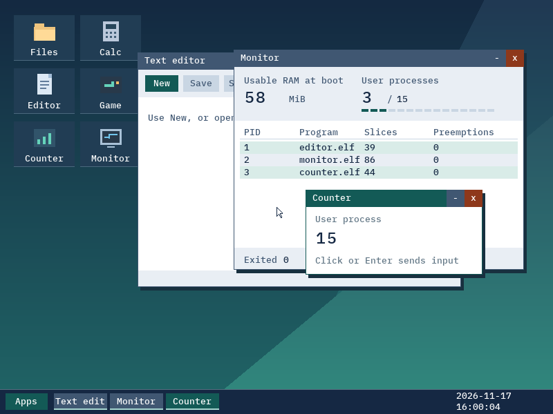

# QEMUでの使い方

[README](../README.md) · [ビルドとテスト](build.md)

## 起動

```sh
make run-gui
```

新規のデータディスクを初めて作成するときは、Files、Editor、Calc、Game、Monitor、CounterのELFが自動で入ります。以前に作ったディスクを使う場合は、QEMUを終了してから一度 `make install-apps` を実行してください。`DATA_DISK=build/other.img` のように別のディスクを使う場合は、インストール時にも同じ値を指定します。ディスク内に同名のファイルがすでにある場合は上書きせずそのまま使います。

macOSでは、QEMUウィンドウの端をドラッグして拡大できます。ウィンドウをすでに開いている場合は、macOSのメニューバーで **View → Zoom To Fit** を有効にしてください。最初から全画面で使う場合は、次のコマンドで起動します。

```sh
make run-gui QEMU_DISPLAY=cocoa,zoom-to-fit=on,full-screen=on
```

## デスクトップの操作

起動すると、壁紙、アプリアイコン、タスクバーを備えたデスクトップが表示されます。アプリはデスクトップのアイコン、またはタスクバー左の **Apps** から開けます。`F1` で **Apps** を開き、`↑`・`↓` と `Enter` で選ぶこともできます。



画面の文字はIBM Plex Mono Mediumを元に、通常サイズと大サイズの字形を別々に作成しています。字形には輪郭の中間色を含み、収録文字は印字可能ASCIIです。ライセンスと生成手順は [assets/fonts/README.md](../assets/fonts/README.md) を参照してください。

- **Files**（F5）でファイル一覧を開きます。ファイルを選んで **Open** または `Enter` を押すと、エディタに内容を表示します。
- **Editor**（F8）で独立したエディタを開きます。ウィンドウの **New**（F2）からファイル名を入力し、**Create** または `Enter` を押すと本文を書けます。**Save**（F3、Ctrl+S）で保存し、**Save As**（F4、Ctrl+Shift+S）では新しい名前を入力して **Save copy** または `Enter` で別ファイルとして保存します。**Cancel** または `Esc` を押すと編集中の本文に戻れます。
- Editorの本文では、クリックで入力位置を指定し、ドラッグで範囲を選択できます。選択した範囲は文字入力で置き換え、`Backspace` や `Delete` で削除できます。長い本文は右側のスクロールバーで移動できます。
- **Counter**（F9）はディスク上の `counter.elf` を起動します。他のGUIアプリと同じく `make install-apps` で配置します。本文をクリックするか `Enter` を押すと一時停止と再開を切り替えられ、ウィンドウを閉じるとアプリが通知を受けて終了します。
- **Calc** は四則演算ができます。マウス操作のほか、数字、演算記号、`Enter` のキー入力でも操作できます。小数は6桁まで扱い、それより下の桁は切り捨てます。
- **Game** はスネークです。`Enter` で開始し、矢印キーで移動します。`Space` で一時停止と再開を切り替えられ、他のウィンドウへ移った場合も一時停止します。
- **Monitor** は起動時に利用可能だったメモリ量と、実行中ユーザープロセスのPID、実行回数、プリエンプト回数を表示します。一覧が1画面に収まらない場合は上下キーで移動できます。

ウィンドウをクリックすると前面に出ます。タイトルバーをドラッグして移動し、右上の **−** で最小化、**×** で閉じます。最小化したウィンドウは、タスクバーのウィンドウ名をクリックすると復元できます。また、`F7` で表示中のウィンドウを切り替え、`F10` で選択中のウィンドウを閉じられます。

未保存のエディタを閉じようとすると確認が表示されます。**Keep** を選ぶと編集に戻り、**Discard** を選ぶと変更を破棄して閉じます。

## ファイルの保存

ファイルは `build/data.img` に保存され、再起動後も開けます。別のイメージを使う場合は `make run-gui DATA_DISK=build/other.img` のように指定してください。新規ディスクでは、ルート直下に1ファイル最大1 MiBのテキストやバイナリを16ファイルまで保存できます（アプリのELFもこの枠を使います）。

Editorで開けるのは、16 KiB以下の印字可能ASCIIとLFで構成された文書です。ファイル名は1〜24文字で、英数字、ピリオド、アンダースコア、ハイフンを使えますが、先頭にピリオドは使えません。

データディスクにはDlangFS4を使い、DlangFS1〜3はマウント対象外です。別のファイルとして新しいディスクを作る場合は `make run-gui DATA_DISK=build/new-data.img` を実行してください。

## シリアルシェル

起動した端末にはシリアルシェルも表示されます。ウィンドウなしで使う場合は `make run` を実行してください。GUIとシリアルシェルは同じファイルを参照します。

| コマンド | 動作 |
| --- | --- |
| `ls` | ファイル一覧を表示 |
| `fsinfo` | マウントしたディスクのファイル数とサイズ上限を表示 |
| `cat NAME` | 本文を表示 |
| `write NAME TEXT` | 1行の本文でファイルを作成または上書き |
| `put NAME BYTES` | バイト数を指定し、16進テキストでファイルを送信 |
| `get NAME` | バイト数とファイル全体を16進テキストで読み出し |
| `rm NAME` | ファイルを削除 |
| `run NAME [&]` | ディスク上のELFを実行（末尾に `&` を付けるとバックグラウンドで起動） |
| `spawn counter` | 診断用の組み込みプロセスを起動（`spin`、`exit`、`fault` も指定可） |
| `ps` | PID、実行回数、タイマーによる中断回数などを表示 |
| `kill PID` | 指定したユーザープロセスを終了 |
| `help` | `echo`、`uname`、`mem`、`clear`、`halt` を含むコマンド一覧を表示 |

`put` では、ホスト側で `xxd -p -c 32 example.bin` のように変換したデータを貼り付け、最後に `.` だけの行を入力します。途中で中止したい場合は `!` だけの行を入力してください。入力が指定バイト数に満たない場合や、不正な16進文字が含まれる場合は保存しません。`get` は `HEX バイト数` に続けて、データを32バイトずつ16進テキストで表示します。

QEMUを終了するにはウィンドウを閉じるか、起動した端末で `Ctrl+C` を押します。`halt` を実行するとゲストCPUを停止します。
